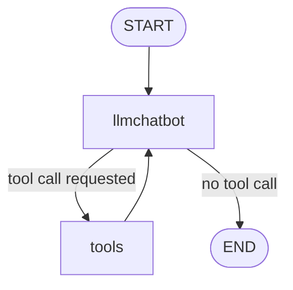

# ReAct Agent with LangGraph

A tool-using AI agent built with **LangGraph** that follows the **ReAct (Reason + Act)** pattern. The agent reads a question, decides whether it needs a tool, calls the tool, reads the result, and keeps looping until it can give a final answer.

The project shows how to build an agent as an explicit **graph of nodes and edges**, including a **conditional edge** that sends each turn either to the tools or to the end.

---

## Features

- **Web search** with [Tavily](https://tavily.com) for up-to-date information (news, markets, current events)
- **A custom Python tool** (`addition`) that the LLM calls with structured arguments
- **Multi-tool reasoning:** a single query can trigger several tools in sequence
- **Fast inference** through [Groq](https://groq.com) running the open-weight `openai/gpt-oss-20b` model
- **Graph visualisation:** the compiled graph renders as a Mermaid diagram inside the notebook

---

## How it works

### The graph



### Nodes

| Node | What it does |
|---|---|
| `llmchatbot` | Sends the conversation so far to the LLM (with the tools bound to it). The LLM either answers directly or asks for one or more tool calls. |
| `tools` | A prebuilt `ToolNode` that runs the requested tool(s): `tavily_search` or `addition`. It adds the results to the conversation as `ToolMessage`s. |

### Edges

| Edge | Type | Purpose |
|---|---|---|
| `START → llmchatbot` | Normal | Every run starts by asking the LLM. |
| `llmchatbot → tools / END` | **Conditional** (`tools_condition`) | If the LLM's last message contains tool calls, go to `tools`; otherwise finish. |
| `tools → llmchatbot` | Normal | Sends tool results back to the LLM so it can reason about them. This loop is what makes it a ReAct agent. |

### State

The graph shares a single state object between nodes:

```python
class State(TypedDict):
    messages: Annotated[list, add_messages]
```

The `add_messages` reducer **appends** each node's new messages to the history instead of overwriting it, so the LLM always sees the full conversation, tool calls and results included.

---

## Example runs

**1. Web search:** *"What is the latest ecommerce news?"*
The LLM calls `tavily_search` with `query="latest ecommerce news"`, then summarises the results.

**2. Custom tool:** *"What is 100 plus 66?"*
```
AI  → tool call: addition(a=100, b=66)
Tool → 166
AI  → 166
```

**3. Two tools in one query:** *"Give me the recent stock market news then add 1864 with 1796"*
The agent searches for market news, calls `addition(1864, 1796)`, and combines both into one answer, ending with `1864 + 1796 = 3660`.

**4. No tool needed:** *"What is 5 to the power of 3"*
There's no exponent tool, so the LLM answers directly (**125**). The conditional edge routes straight to `END`.

---

## Project structure

```
.
├── ReAct.ipynb     # The full agent: setup, tools, graph, and example runs
├── .gitignore      # Keeps .env (API keys) and environment folders out of Git
└── README.md
```

---

## Getting started

### 1. Clone the repository
```bash
git clone https://github.com/Paulokw/ReAct-Agent-with-LangGraph.git
cd ReAct-Agent-with-LangGraph
```

### 2. Create and activate a virtual environment
```bash
python -m venv venv
# Windows
venv\Scripts\activate
# macOS / Linux
source venv/bin/activate
```

### 3. Install dependencies
```bash
pip install langgraph langchain-groq langchain-tavily python-dotenv ipython jupyter
```

### 4. Add your API keys
Create a `.env` file in the project root:
```env
GROQ_API_KEY=your_groq_api_key
TAVILY_API_KEY=your_tavily_api_key
```
- Groq key: <https://console.groq.com/keys>
- Tavily key: <https://app.tavily.com>

`.env` is listed in `.gitignore`, so your keys are never committed.

### 5. Run the notebook
```bash
jupyter notebook ReAct.ipynb
```
Run the cells from top to bottom. The last cells show example queries, and you can add your own with:
```python
response = graph.invoke({"messages": "Your question here"})
for m in response["messages"]:
    m.pretty_print()
```

---

## Adding your own tools

Any Python function with **type hints and a docstring** can be used as a tool. The LLM reads the docstring to decide when to call it:

```python
def multiply(a: int, b: int) -> int:
    """Multiply two numbers.

    Args:
        a (int): The first number.
        b (int): The second number.
    """
    return a * b

tools = [tool, addition, multiply]   # then rebuild llm_with_tools and the graph
```

---

## Tech stack

- [LangGraph](https://langchain-ai.github.io/langgraph/): graph-based agent orchestration
- [LangChain](https://python.langchain.com/): LLM and tool interfaces
- [Groq](https://groq.com): LLM inference (`openai/gpt-oss-20b`)
- [Tavily](https://tavily.com): search API built for LLM agents
- [python-dotenv](https://pypi.org/project/python-dotenv/): loads API keys from `.env`

---

## Possible extensions

- Add **memory** (a LangGraph checkpointer) so the agent remembers earlier turns
- Add more tools (calculator, Wikipedia, a database query)
- Stream responses token by token with `graph.stream(...)`
- Wrap the agent in a simple **Streamlit** or **Gradio** chat UI
